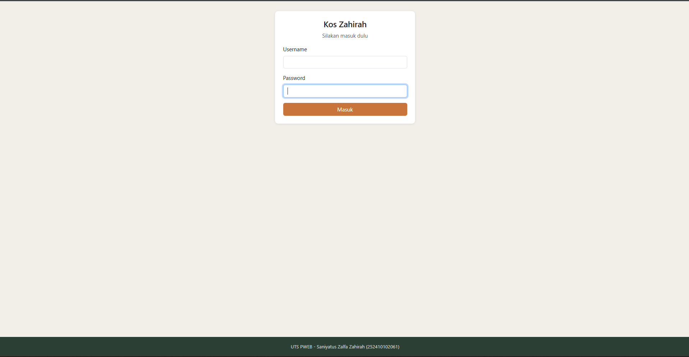
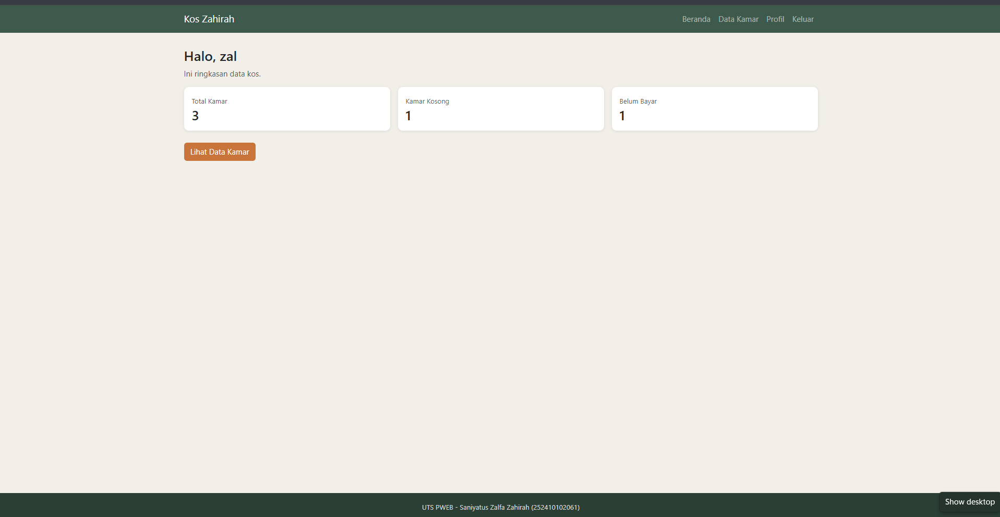
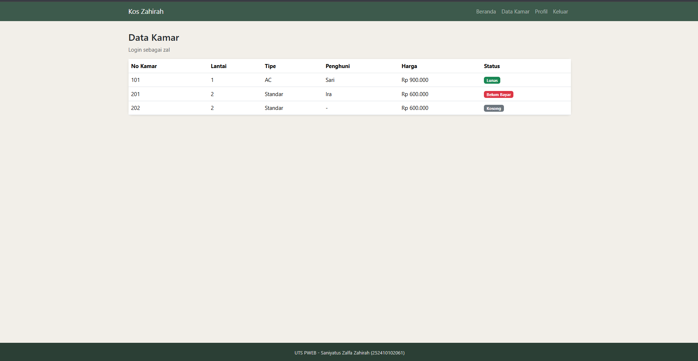
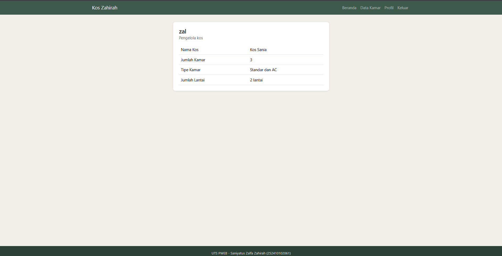

# Kos Zahirah - Aplikasi Pengelolaan Kos
UTS Pemrograman Web Genap 25/26

- Nama: Saniyatus Zalfa Zahirah
- NIM: 252410102061
- Kelas: PWEB A

## Tentang wbesite
Kos Zahirah adalah website sederhana untuk mengelola data kos. Lewat website ini pengelola bisa login, melihat ringkasan kamar di beranda, melihat daftar kamar beserta penghuni dan status pembayarannya, serta melihat profil kos.

## Fitur
- Login simulasi, username dikirim ke halaman lain lewat parameter URL
- Beranda berisi ringkasan data kamar
- Data kamar tipe Standar (lantai 2) dan AC (lantai 1)
- Profil pengelola dan informasi kos

## Teknologi
Laravel, Blade, Bootstrap (CDN), CSS sendiri. Tanpa database, data disimpan dalam array di Controller.

## Cara Menjalankan
composer install
cp .env.example .env
php artisan key:generate
php artisan serve

Lalu buka `localhost:8000`.

## Screenshot
### Login

### Beranda

### Data Kamar

### Profil
